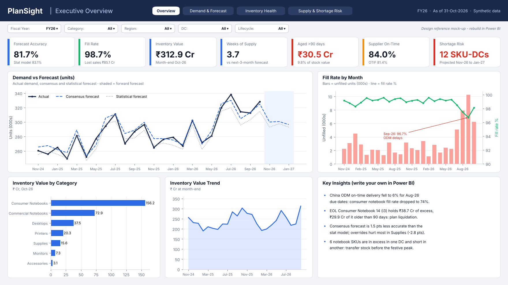
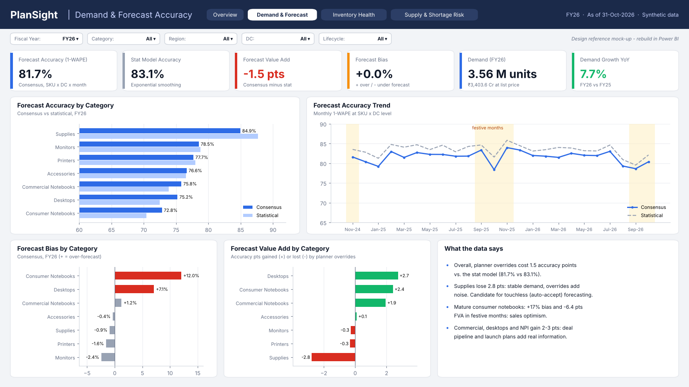
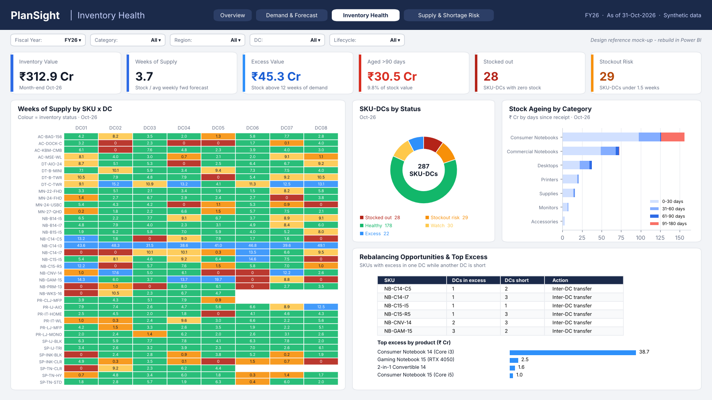
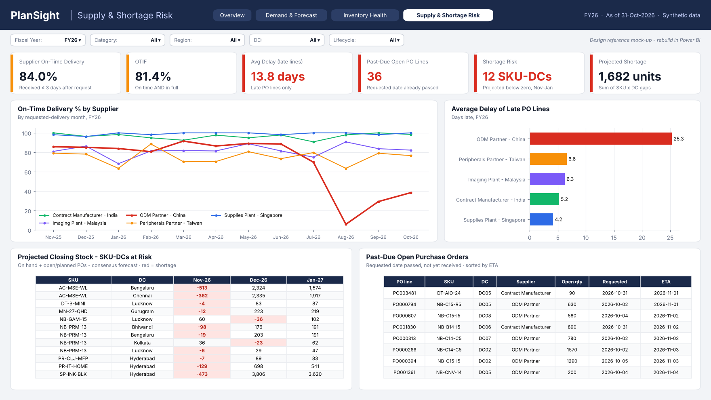
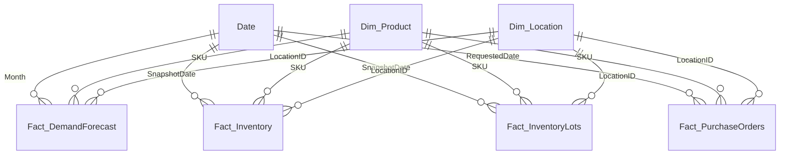

# PlanSight: Supply Chain Planning Dashboard (Power BI)

A Power BI dashboard for a supply chain planning team, covering **demand planning, inventory health and supply risk** across 37 SKUs and 8 distribution centres in India over FY25–FY26 (fiscal year Nov–Oct).

It answers the questions a planning team asks in its monthly review:

- **Demand:** How accurate is our forecast? Do planner overrides add value or noise?
- **Inventory:** Where are we stocked out, at risk, in excess or holding aged stock? Can we rebalance between DCs?
- **Supply:** Which suppliers are late? What will run out in the next 3 months?

> **Data note:** all data is **synthetic**, generated in Python (`scripts/generate_data.py`) to mimic a PC and printing supply chain in India. It includes realistic events: festive seasonality, B2B deals, product launches and an end-of-life transition, a supplier disruption, and a regional demand shift. No company data is used.

<!-- Replace these mock-ups with screenshots of your own report: docs/screenshots/page1.png ... -->


| Demand & Forecast | Inventory Health | Supply & Shortage Risk |
|---|---|---|
|  |  |  |

---

## Key findings (FY26, as of 31-Oct-2026)

| # | Finding | So what |
|---|---|---|
| 1 | The China ODM's on-time delivery fell to **6%** for Aug-26 due dates. Consumer-notebook fill rate dropped to **74%**, and FY26 lost sales on consumer notebooks reached **₹51 Cr**. | Dual-source key notebook SKUs. Raise safety stock on ODM-sourced items ahead of the festive peak. |
| 2 | The consensus forecast is **1.5 pts less accurate** than the statistical model overall (81.7% vs 83.1%). Supplies lose **2.8 pts**; mature consumer notebooks show **+17% bias** in festive months. | Move stable categories (supplies) to touchless forecasting. Challenge festive sales uplifts with history. |
| 3 | Overrides **do** add 2–3 pts in commercial notebooks, desktops and launches, where sales knows about deals and launch plans. | Keep overrides where planners have information the model doesn't. |
| 4 | **₹38.7 Cr of ₹45.3 Cr excess** and **₹29.9 Cr of ₹30.5 Cr aged >90-day** stock sit in one end-of-life notebook. Its forecast ran 1.3–2.4× actual demand for 3 months (May–Jul) after phase-out began. | Liquidate through a channel promotion, and freeze replenishment when an EOL is announced. |
| 5 | **6 notebook SKUs** are in excess in one DC while short in another. Hyderabad demand grew **+18.5%** (network +7.7%) and has the lowest fill rate (96.4%). | Transfer stock between DCs instead of placing new POs. Re-baseline the Hyderabad forecast. |
| 6 | **12 SKU-DCs** are projected to go below zero in Nov-26 to Jan-27 (1,682 units), and **36 PO lines** are already past due. | Expedite the past-due POs and rebalance from excess DCs. |

---

## Data model

A star schema with four fact tables at different grains, sharing conformed dimensions:



| Table | Grain | Rows |
|---|---|---|
| Fact_DemandForecast | Month × SKU × DC (actual, statistical and consensus forecast) | 7,749 |
| Fact_Inventory | Month-end × SKU × DC (opening, receipts, shipped, unfilled, closing, safety stock) | 6,888 |
| Fact_InventoryLots | Month-end × SKU × DC × receipt lot (for ageing) | 10,011 |
| Fact_PurchaseOrders | PO line (received, open, planned) | 7,061 |
| Dim_Product / Dim_Location / Date | 37 SKUs / 8 DCs / fiscal calendar (Nov–Oct) | |

## KPI definitions

| KPI | Definition |
|---|---|
| Forecast Accuracy | 1 − WAPE, where WAPE = Σ\|forecast − actual\| ÷ Σ actual, with the error taken at SKU × DC × month before summing |
| Forecast Bias | (Σ forecast − Σ actual) ÷ Σ actual; + = over-forecast |
| Forecast Value Add | Consensus accuracy − statistical-model accuracy (pts) |
| Fill Rate | Units shipped ÷ units demanded |
| Weeks of Supply | Closing stock ÷ (next-3-month consensus forecast ÷ 13) |
| Inventory Status | Stocked out (0) · Stockout risk (< 1.5 wks) · Healthy (1.5–8) · Watch (8–12) · Excess (> 12 wks) |
| Excess Value | Stock above 12 weeks of forward demand × unit cost |
| Aged Stock | Value of receipt lots older than 90 days (FIFO) |
| On-Time Delivery / OTIF | PO lines received ≤ 3 days after the requested date / and in full |
| Projected Shortage | On hand + open/planned PO receipts by ETA − cumulative consensus forecast < 0 |

## What's in the repo

```
PlanSight-PowerBI/
├── PlanSight.pbix              ← the report (add after building)
├── BUILD_GUIDE.md              ← step-by-step build, checkpoints, interview prep
├── data/raw/                   ← source extracts (wide forecast file, messy ERP PO export)
├── data/clean/                 ← same data after the Power Query steps (fallback / check)
├── powerquery/*.m              ← M code for every query
├── dax/measures.dax            ← date table + 45+ measures, commented
├── theme/PlanSight-theme.json  ← report theme
├── scripts/generate_data.py    ← synthetic data generator (simulation of demand, forecasts, replenishment, FIFO lots)
├── scripts/build_clean.py      ← pandas mirror of the Power Query steps
├── scripts/kpi_reference.py    ← independent pandas implementation of every KPI, used to validate the DAX
└── docs/mockups/               ← design references
```

## Skills demonstrated

- **Power Query (M):** unpivot/pivot of a wide planning export, multi-key merges, locale-aware date parsing, de-duplication, conditional columns
- **Data modelling:** star schema, fiscal date table, disconnected table for status classification
- **DAX:** WAPE and FVA, semi-additive snapshot measures, time intelligence, forward-looking projections with `REMOVEFILTERS`, SKU × DC iteration with `CROSSJOIN`, field-value conditional formatting
- **Python:** monthly supply chain simulation (order-up-to replenishment, supplier delays, FIFO lots) and KPI validation in pandas
- **Supply chain:** demand planning, forecast value add, inventory health, ageing, supplier OTD/OTIF, shortage projection, DC rebalancing

## Reproduce

```bash
pip install pandas numpy
python scripts/generate_data.py   # writes data/raw
python scripts/build_clean.py     # writes data/clean
python scripts/kpi_reference.py   # prints the checkpoint KPI values
```

Then follow [BUILD_GUIDE.md](BUILD_GUIDE.md) to build the report in Power BI Desktop.
